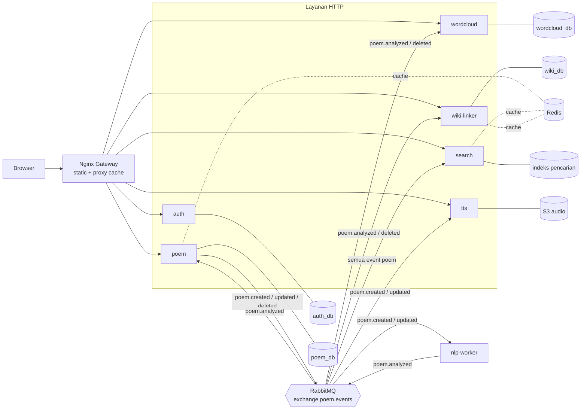
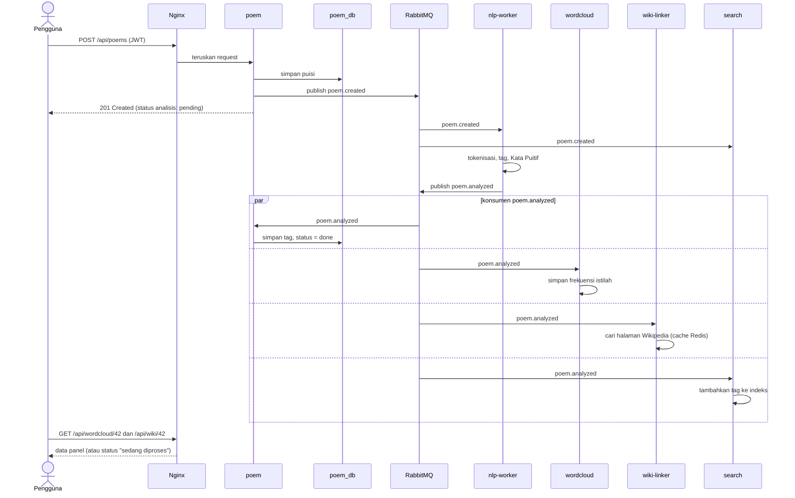

# Dokumen Rancangan Arsitektur: Platform Publikasi Karya Sastra Puisi

Hands On Arsitektur Aplikasi Scalable (Microservice - Event Driven) · 2026-11-03

## 1. Pendahuluan

Dokumen ini merancang transformasi aplikasi Publikasi Karya Sastra Puisi dari monolit stateful (Tugas 1) menjadi platform berbasis layanan terdistribusi yang stateless, digerakkan event (Event-Driven Architecture), dan dapat di-scale per komponen.

Arsitektur target memiliki tujuh layanan di balik satu gerbang Nginx: **auth**, **poem**, **nlp-worker**, **wordcloud**, **search**, **wiki-linker**, dan **tts** (opsional). Komunikasi sinkron dipakai hanya untuk alur yang menunggu hasil langsung (login, baca, cari). Semua pemrosesan berat (NLP, word cloud, tautan Wikipedia, TTS) berjalan asinkron lewat **RabbitMQ**.

Ruang lingkup dokumen: keputusan arsitektur, kontrak antar-layanan, strategi caching, ketahanan, observability, SLO, deployment, dan rencana uji beban. Kode implementasi berada di luar dokumen ini.

## 2. Analisis Tugas 1 (Kondisi Awal)

Tugas 1 adalah satu proses Python (`http.server`, satu file `server.py`) dengan satu database MySQL dan sesi berbasis file JSON di filesystem container. Lima keterbatasan sistemik di bawah ini menjadi alasan setiap keputusan desain pada bagian berikutnya.

| Keterbatasan | Penyebab di Tugas 1 | Perbaikan pada arsitektur target |
| --- | --- | --- |
| Retrograde scalability | Sesi disimpan di file lokal; request pengguna terikat ke satu instance | Stateless: autentikasi memakai JWT yang diverifikasi lokal oleh tiap layanan |
| Scale all-or-nothing | Seluruh fungsi satu proses; menambah kapasitas berarti menggandakan semuanya | Layanan terpisah; hanya komponen yang padat (mis. nlp-worker, tts) yang di-scale |
| Single Point of Failure pada database | Satu MySQL untuk semua data | Database per layanan (logis) dan cache Redis untuk jalur baca |
| Tight coupling | Semua logika dalam satu kode; pemrosesan berat akan memblokir request | Event-driven: poem service hanya mempublikasikan event lalu segera merespons |
| Cascading failure | Kegagalan satu fitur dapat menjatuhkan seluruh aplikasi | Isolasi per container, queue durable, retry dan dead-letter queue |

Domain dari Tugas 1 tetap dipakai: tabel `users` dan `puisi`, hashing password PBKDF2, frontend HTML/JS, serta fitur gambar puisi (Lambda, S3, CloudFront). Yang diganti adalah struktur dan mekanisme komunikasinya.

## 3. Gambaran Arsitektur Target

Semua lalu lintas pengguna masuk lewat Nginx. Layanan HTTP menjawab request sinkron; setiap perubahan data dipublikasikan sebagai event ke RabbitMQ, dan worker serta layanan analisis mengonsumsinya secara mandiri.



Prinsip desain:

1. **Satu pintu masuk.** Hanya Nginx yang terbuka ke luar; layanan lain hanya terjangkau di jaringan internal Docker.
2. **Sinkron untuk membaca, asinkron untuk menghitung.** Request pengguna tidak pernah menunggu NLP, Wikipedia, atau TTS.
3. **Satu pemilik per data.** Setiap data ditulis oleh satu layanan; layanan lain memperolehnya lewat event atau API, bukan lewat database bersama.
4. **Stateless.** Instance dapat ditambah, dihapus, atau diganti tanpa kehilangan sesi atau data.
5. **Pengayaan tanpa ketergantungan.** Layanan analisis (word cloud, wiki, search, tts) hanya bergantung pada event, tidak saling memanggil.

## 4. Katalog Layanan

Setiap layanan berjalan di container sendiri, tidak menyimpan state di memori lokal, dan hanya memiliki databasenya sendiri. Layanan yang diberi tanda "worker" tidak membuka API; ia hanya mengonsumsi event.

| Layanan | Tanggung jawab | API sinkron (lewat Nginx) | Data milik sendiri | Event dipublikasi | Event dikonsumsi |
| --- | --- | --- | --- | --- | --- |
| gateway (Nginx) | Titik masuk tunggal, file statis frontend, proxy cache, rate limiting | semua `/api/*` | - | - | - |
| auth | Registrasi, login, penerbitan JWT | `POST /api/auth/register`, `POST /api/auth/login` | `auth_db`: users (hash PBKDF2) | - | - |
| poem | CRUD puisi, cache baca di Redis, menyimpan tag dan status analisis | `GET/POST /api/poems`, `GET/PUT/DELETE /api/poems/{id}` | `poem_db`: puisi | `poem.created`, `poem.updated`, `poem.deleted` | `poem.analyzed` |
| nlp-worker | Satu pipeline NLP: tokenisasi, stopword, ekstraksi kata kunci, tag, dan Kata Puitif | worker | tanpa database (stateless) | `poem.analyzed` | `poem.created`, `poem.updated` |
| wordcloud | Menghitung dan menyajikan frekuensi istilah dominan | `GET /api/wordcloud/{poem_id}` | `wordcloud_db`: frekuensi per puisi | - | `poem.analyzed`, `poem.deleted` |
| search | Mengindeks dan mencari puisi (judul, isi, tag) | `GET /api/search?q=` | indeks pencarian sendiri | - | `poem.created`, `poem.updated`, `poem.deleted`, `poem.analyzed` |
| wiki-linker | Mencocokkan Kata Puitif dengan halaman Wikipedia | `GET /api/wiki/{poem_id}` | `wiki_db`: tautan per puisi; cache lookup di Redis | - | `poem.analyzed`, `poem.deleted` |
| tts (opsional) | Mengubah isi puisi menjadi audio, menyimpan file ke S3 | `GET /api/tts/{poem_id}` (status dan URL audio) | metadata status; file audio di S3 | - | `poem.created`, `poem.updated` |

Autentikasi: setiap layanan memverifikasi JWT (HS256, secret bersama lewat environment variable) secara lokal, tanpa memanggil auth service pada tiap request. Dengan begitu auth tidak menjadi bottleneck, dan restart container tidak memutus sesi pengguna.

## 5. Katalog Event (RabbitMQ)

Semua event dikirim ke satu topic exchange bernama `poem.events`. Setiap konsumen memiliki queue durable sendiri yang di-bind ke routing key yang diminatinya, sehingga satu event dapat diproses beberapa layanan tanpa saling menunggu.

| Routing key | Dipublikasi oleh | Payload (JSON) | Konsumen (queue) |
| --- | --- | --- | --- |
| `poem.created` | poem | `event_id`, `poem_id`, `user_id`, `judul`, `isi`, `kategori`, `occurred_at` | nlp.q, search.q, tts.q |
| `poem.updated` | poem | sama dengan `poem.created` | nlp.q, search.q, tts.q |
| `poem.deleted` | poem | `event_id`, `poem_id`, `occurred_at` | search.q, wordcloud.q, wiki.q |
| `poem.analyzed` | nlp-worker | `event_id`, `poem_id`, `tags[]`, `kata_puitif[]`, `terms[{term, count}]`, `occurred_at` | poem.q, wordcloud.q, wiki.q, search.q |

Contoh payload `poem.analyzed`:

```json
{
  "event_id": "7c1f0a52-3b0e-4b9e-9d1a-0c2f6c8e1a11",
  "correlation_id": "e2a4c9d0-55b1-4f0a-8f3e-2b7d9c1a4e66",
  "poem_id": 42,
  "tags": ["alam", "rindu"],
  "kata_puitif": ["senja", "cakrawala"],
  "terms": [{"term": "senja", "count": 3}, {"term": "langit", "count": 2}],
  "occurred_at": "2026-11-03T10:15:00Z"
}
```

Aturan kontrak yang berlaku untuk semua event:

- Setiap event membawa `event_id` (UUID) dan `correlation_id` agar konsumen dapat bersikap idempoten dan log dapat dilacak lintas layanan.
- Konsumen memakai manual acknowledgement dan `prefetch_count` yang kecil; pesan baru di-ack setelah hasil tersimpan.
- Pesan yang gagal diproses diulang dengan backoff, lalu dipindahkan ke dead-letter queue (`*.dlq`) setelah batas percobaan.
- Perubahan skema bersifat additive (field baru boleh ditambah, field lama tidak dihapus) agar konsumen lama tidak rusak.

## 6. Alur Data: Submit Puisi hingga Analisis Selesai

Pengguna menerima respons sukses segera setelah puisi tersimpan. Analisis berjalan di belakang layar, dan frontend memuat hasilnya per panel ketika sudah tersedia.



Jika salah satu konsumen sedang mati, langkah miliknya menunggu di queue durable dan dijalankan saat layanan hidup kembali; langkah lain dan respons ke pengguna tidak terpengaruh.

## 7. Strategi Multi-Tier Caching

Jalur baca (daftar puisi, detail puisi, pencarian, tautan Wikipedia) dilindungi tiga lapisan, sehingga sebagian besar request tidak pernah menyentuh database.

| Tier | Lokasi | Yang di-cache | TTL awal (dapat disetel) | Invalidasi |
| --- | --- | --- | --- | --- |
| 1 | Browser dan Nginx `proxy_cache` | File statis frontend, GET publik yang tidak bergantung pengguna | statis: lama; API: pendek (detik) | TTL pendek |
| 2 | Redis, pola cache-aside | Detail puisi, hasil pencarian populer, hasil lookup Wikipedia | puisi: menit; pencarian: 30 sampai 60 detik; Wikipedia: jam sampai hari | Hapus key saat `poem.updated` atau `poem.deleted` |
| 3 | Database layanan | Sumber kebenaran | - | - |

Alurnya: layanan memeriksa Redis; jika miss, ia membaca database, menyimpan hasilnya ke Redis dengan TTL, lalu mengembalikannya. Penulisan selalu ke database terlebih dahulu, lalu key terkait dihapus. Hasil lookup Wikipedia memakai TTL panjang karena isi halaman jarang berubah dan API eksternal rentan terkena rate limit.

Nilai TTL di atas adalah titik awal dan akan disetel berdasarkan hasil uji beban (bagian 12).

## 8. Desentralisasi Database

Setiap layanan memiliki skema dan kredensial database sendiri, dan tidak ada layanan yang membaca tabel milik layanan lain. Data lintas layanan hanya bergerak lewat event atau API.

| Layanan | Penyimpanan | Catatan |
| --- | --- | --- |
| auth | `auth_db` (MySQL) | Tabel users; hash PBKDF2 dari Tugas 1 dipindahkan |
| poem | `poem_db` (MySQL) | Tabel puisi dari Tugas 1, ditambah kolom tag dan status analisis |
| wordcloud | `wordcloud_db` | Frekuensi istilah per puisi |
| wiki-linker | `wiki_db` dan Redis | Tautan per puisi; cache lookup di Redis |
| search | Indeks pencarian sendiri | Dapat dibangun ulang dari event |
| tts | S3 dan metadata status | File audio tidak disimpan di database |

**Kompromi infrastruktur.** Untuk menghemat memori pada instance EC2 yang kecil, dalam prototipe seluruh database logis dapat berjalan pada satu server MySQL dengan database dan pengguna terpisah per layanan. Ini memisahkan data dan hak akses secara logis, tetapi server MySQL tetap menjadi satu titik kegagalan fisik. Pada produksi, setiap database dipindahkan ke instance sendiri tanpa mengubah kode layanan, karena tiap layanan hanya mengenal connection string miliknya.

Tidak ada antrean pekerjaan di database pusat. Seluruh antrean kerja ada di RabbitMQ, sesuai ketentuan tugas.

## 9. Ketahanan dan Isolasi Kegagalan

Kegagalan satu layanan analisis tidak boleh menghentikan penerbitan puisi. Mekanisme berikut menjaga hal itu.

- **Stateless.** Tidak ada sesi atau data pengguna di memori container. Container dapat dimatikan, diganti, atau digandakan kapan saja.
- **Pemisahan jalur.** Poem service hanya menyimpan puisi dan mempublikasikan event, lalu merespons. Jika nlp-worker, wiki-linker, atau tts mati, pesan menunggu di queue durable dan diproses setelah layanan hidup kembali.
- **Retry dan dead-letter queue.** Kegagalan sementara (mis. API Wikipedia timeout) diulang dengan backoff; pesan yang tetap gagal dipindahkan ke DLQ untuk diperiksa, bukan dibuang.
- **Idempotency.** Konsumen mencatat `event_id` yang sudah diproses atau menulis dengan upsert berdasarkan `poem_id`, sehingga pengiriman ganda tidak menghasilkan data ganda.
- **Timeout dan degradasi.** Setiap panggilan keluar (Redis, database, Wikipedia, penyedia TTS) memiliki timeout. Pada halaman detail, setiap panel (word cloud, Kata Puitif, audio) dimuat terpisah; panel yang gagal menampilkan status "sedang diproses" atau "tidak tersedia" tanpa merusak panel lain.
- **Backpressure.** `prefetch_count` kecil pada worker berat (nlp, tts) mencegah satu worker menimbun pekerjaan; kedalaman queue menjadi sinyal untuk menambah replika.
- **Health check.** Setiap layanan membuka `/health`, dipakai Docker Compose untuk restart otomatis.

## 10. Observability dan SLO

Sistem memakai tiga sumber sinyal: metrik, log, dan status queue.

- **Metrik.** Setiap layanan membuka `/metrics` (jumlah request, latensi, error, cache hit/miss, durasi dan jumlah job). Prometheus mengambil data tiap beberapa detik; Grafana menampilkannya secara real-time.
- **Log.** Log berformat JSON ke stdout dengan `correlation_id` yang dibawa dari request HTTP ke dalam pesan RabbitMQ, sehingga satu puisi dapat dilacak dari submit sampai analisis selesai.
- **Queue.** RabbitMQ management menampilkan kedalaman queue, laju publish dan consume, serta isi DLQ.

Target SLO berikut adalah usulan awal. Angkanya akan dikonfirmasi atau disesuaikan setelah uji beban pada instance yang sebenarnya.

| SLI | Target SLO (usulan) | Sumber ukur |
| --- | --- | --- |
| Latensi baca puisi (`GET /api/poems/{id}`) | p95 di bawah 300 ms | Prometheus, histogram latensi poem |
| Latensi submit puisi (`POST /api/poems`) | p95 di bawah 500 ms (tidak termasuk analisis asinkron) | Prometheus, histogram latensi poem |
| Latensi pencarian (`GET /api/search`) | p95 di bawah 300 ms | Prometheus, histogram latensi search |
| Ketersediaan API | 99% request berstatus non-5xx | Prometheus, rasio status |
| Keterlambatan analisis | 99% puisi selesai dianalisis dalam 30 detik setelah submit | Selisih waktu `poem.created` ke `poem.analyzed` |

Peringatan dasar: kedalaman queue yang terus naik, isi DLQ yang tidak nol, dan rasio error di atas ambang pada panel Grafana.

## 11. Deployment dan Strategi Scaling

Seluruh sistem dijalankan dengan satu file Docker Compose di AWS EC2, melanjutkan cara deployment Tugas 1. Container terdiri dari gateway, tujuh layanan aplikasi, MySQL, Redis, RabbitMQ, Prometheus, dan Grafana.

**Ukuran instance.** Tugas 1 berjalan di t2.micro (1 GB RAM). Dengan sekitar sepuluh container tambahan, memori 1 GB hampir pasti tidak cukup; instance dengan RAM 2 sampai 4 GB (mis. kelas t3.small atau t3.medium) perlu dipilih, dan ukuran akhirnya ditentukan dari pengukuran saat uji beban. Setiap container diberi batas memori agar satu layanan tidak menghabiskan RAM host.

**Cara scale.**

- Worker (nlp-worker, tts, wordcloud) di-scale dengan `docker compose up --scale <layanan>=N`; RabbitMQ membagi pesan antar replika secara otomatis.
- Layanan HTTP (poem, search) di-scale dengan menambah replika di belakang Nginx (upstream), dimungkinkan karena layanan stateless.
- Penambahan replika tidak memerlukan perubahan kode atau konfigurasi sesi.

**Konfigurasi.** Kredensial dan secret JWT disimpan di file `.env` yang tidak di-commit; repositori hanya memuat `.env.example`. Aset statis dan gambar puisi tetap dapat dilayani lewat S3 dan CloudFront seperti pada Tugas 1.

## 12. Rencana Uji Beban (Stress Test)

Uji beban membuktikan bahwa target SLO pada bagian 10 tercapai pada instance yang sebenarnya, dan menunjukkan bahwa menambah replika meningkatkan kapasitas. Alat yang diusulkan adalah k6 atau Locust, dijalankan dari luar instance.

| Skenario | Beban | Yang diamati | Kriteria lulus |
| --- | --- | --- | --- |
| Baca puisi dan pencarian | Naikkan jumlah pengguna virtual bertahap pada `GET /api/poems/{id}` dan `GET /api/search` | Latensi p95, cache hit ratio, error rate | Sesuai SLO latensi baca dan pencarian |
| Submit puisi | Banyak `POST /api/poems` bersamaan | Latensi submit, kedalaman queue | Latensi submit sesuai SLO; tidak ada puisi hilang |
| Antrean analisis | Publikasikan banyak event `poem.created` langsung ke RabbitMQ | Kedalaman queue, waktu `poem.created` ke `poem.analyzed` | Queue terkuras setelah beban berhenti; keterlambatan analisis sesuai SLO |
| Scale-out | Ulangi skenario antrean dengan 1 lalu 3 replika nlp-worker | Throughput job per menit | Throughput meningkat seiring replika |
| Ketahanan | Matikan satu layanan (mis. wiki-linker) saat beban berjalan, lalu hidupkan kembali | Error rate poem, isi queue wiki | Submit puisi tetap berhasil; pesan terproses setelah layanan kembali |

Praktik pelaksanaan:

- Layanan eksternal (Wikipedia, penyedia TTS) diganti stub saat uji beban skala besar agar hasil tidak terdistorsi rate limit dan biaya; satu uji kecil memakai layanan asli.
- Uji dijalankan pada ukuran instance yang sama dengan deployment demo.
- Panel Grafana (latensi, error, kedalaman queue, CPU) diambil sebagai bukti pada laporan.
- Hasil dipakai untuk menyetel TTL cache, `prefetch_count`, dan jumlah replika.

## 13. Pemetaan terhadap Kebutuhan Tugas, Risiko, dan Keputusan Terbuka

Setiap ketentuan pada soal terpenuhi oleh satu atau lebih keputusan di dokumen ini.

| Ketentuan soal | Pemenuhan | Bagian |
| --- | --- | --- |
| Dekomposisi menjadi layanan independen di isolated container | Tujuh layanan, masing-masing satu container | 4 |
| Stateless | JWT diverifikasi lokal; tidak ada sesi di memori | 4, 9 |
| Event-Driven Architecture dengan RabbitMQ atau Kafka | RabbitMQ, topic exchange `poem.events` | 5, 6 |
| Pemrosesan asinkron untuk tugas compute-intensive dan I/O-bound | NLP, word cloud, tautan Wikipedia, dan TTS lewat queue | 5, 6 |
| Multi-Tier Caching dengan Redis | Nginx proxy cache, Redis cache-aside, database | 7 |
| Database-per-Service | Skema dan kredensial terpisah per layanan | 8 |
| Tanpa antrean pusat di database tunggal | Seluruh antrean di RabbitMQ | 8 |
| Nginx sebagai gerbang tunggal | Gateway untuk semua `/api/*` dan frontend | 3, 4 |
| Observability terdistribusi dan real-time | Prometheus, Grafana, log JSON, correlation ID | 10 |
| High availability dan SLO | Isolasi kegagalan, retry, DLQ, target SLO terukur | 9, 10 |

**Risiko.**

- Memori instance EC2 terbatas untuk sekitar sepuluh container; mitigasi dengan batas memori per container dan instance yang lebih besar.
- Server MySQL bersama tetap menjadi titik kegagalan fisik pada prototipe; dicatat sebagai kompromi pada bagian 8.
- API Wikipedia dan penyedia TTS dapat membatasi laju atau gagal; mitigasi dengan cache, retry, dan stub saat uji beban.
- Ekstraksi Kata Puitif untuk bahasa Indonesia bergantung pada kualitas pustaka NLP; kualitasnya perlu dievaluasi manual.

**Keputusan terbuka.**

- [ ] Mesin pencarian: MySQL FULLTEXT atau Meilisearch (ditentukan pemilik layanan search setelah uji beban).
- [ ] TTS: AWS Polly, gTTS, atau tidak diimplementasikan (layanan masih tentatif).
- [ ] Pustaka NLP bahasa Indonesia untuk nlp-worker.
- [ ] Ukuran instance EC2 dan batas anggaran AWS.
- [ ] Apakah fitur gambar puisi (Lambda) dipertahankan pada versi baru.
